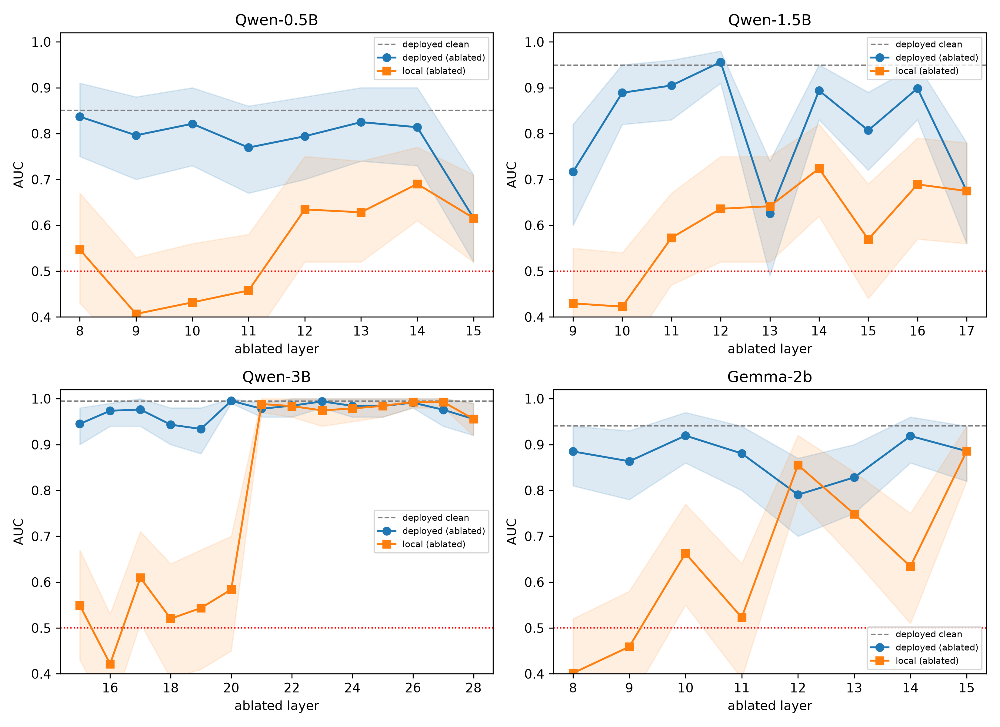
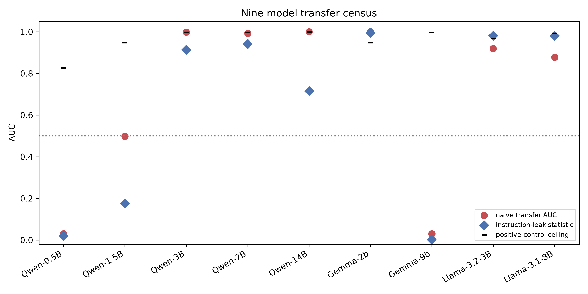

# What Deception Probes Read and How Evaluations of Them Fail

[](https://doi.org/10.5281/zenodo.21632023)

Code, data, and regenerable results for the paper *What Deception Probes Read and How Evaluations of Them Fail* (Andres Garcia, 2026); [read the paper (PDF)](paper/Garcia_2026_What_deception_probes_read_and_how_evaluations_of_them_fail.pdf).

Revised October 2026 after workshop review. No measured value changed. The revision corrects one rounded value and adds quantities derived from existing counts. The version submitted to the workshop in August 2026 is tagged `v1.0.2`.

Linear probes on LLM activations are a leading proposal for detecting deception. The standard check of whether one works is instructed transfer, in which a probe trained on contrast pairs is applied to a model told to lie and should separate its lies from its honest answers. This repository holds the pipeline, data, and results for a study of whether that check, and the ablation experiments used to say where a probe's signal is computed, can be trusted.

The probes are trained in a teacher-forced Yes/No format. Each statement is placed in a prompt that asks "Is this statement true? Answer Yes or No.", and the code appends a Yes or No answer that the model never chose, so the training label records whether the answer agrees with the fact. We call that truth-consistency, and we keep the conventional name "deception probe" for the probe trained on it. Whether such a probe detects lying is tested only in the instructed-transfer section of the paper.

## Main findings

The transfer census covers nine instruction-tuned models up to 14B. Per-layer ablations cover four of them (Qwen2.5-0.5B, 1.5B and 3B, and Gemma-2-2b).

- **The instructed-transfer test confounds the instruction with the lie.** Every lie in the transfer set is given under the lie instruction and every honest answer under the honest one, so a probe that only detects the instruction scores as well as one that detects lying. Naive transfer AUCs range from 0.030 to 1.000 across the nine models, three of them at or above their own positive-control ceiling, and none of these values can be read as written.
- **A regression can remove the confound only when a model lies in both directions, and most models don't.** Under a plain lie instruction, all five Qwen models answer No to all 400 statements and Llama-3.2-3B answers No to 388, so six models lie almost entirely by denial. Gemma-9b leans the other way (24% of its lies are denials) and fails the answer-balance gate we fixed in advance, so we haven't run the regression for it. In the two models that pass, Gemma-2b and Llama-3.1-8B, the instruction effect on the probe score is about four times the false-answer effect, and the false-answer effect has opposite signs in the two models.
- **The probe responds to the instruction in all nine models, although it never saw one in training.** The instruction-leak statistic is the probe's AUC at separating truthful answers given under the honest instruction from truthful answers given under the lie instruction. Neither group contains a lie, yet the statistic is more than 0.15 from chance in every model, and in eight of nine it stays there when statement truth is held fixed. This check needs no gate, so it doesn't rest on the two models that pass one.
- **Where the truth-consistency signal is computed differs in every model.** We call a layer false-answer-specific when ablating it hurts the deception probe more than a truth probe. These layers form a two-layer band at Qwen-1.5B (L15 and L16), four layers at Gemma-2b (L9, L11, L13 and L14), and two layers at Qwen-3B (L18 and L20) whose damage is mostly gone by the deployed readout, and Qwen-0.5B has none. Significance is corrected within each model by Benjamini-Hochberg, which removes one of 39 cells and none of the layers listed here.
- **The most damaging ablation isn't the false-answer-specific one.** In each of the three models with false-answer-specific layers, the ablation that most damages the deployed probe falls outside the set (L13 at Qwen-1.5B, L12 at Gemma-2b, L19 at Qwen-3B). Our own layer-selection rule, fixed in advance, picked a false-answer-specific layer in two of four models.
- **The choice of metric reversed two of our own conclusions.** The clearest case is at Qwen-3B, where one ablation lowers balanced accuracy by 0.231 but AUC by only 0.013, because scores crossed the decision threshold while their ranking barely moved. That the two metrics can diverge is well known, and what this adds is a case in probe evaluation where the divergence produced a significant result we had accepted. The pre-registered test of one explanation, uniform shrinkage of the residual norm, gave a partial fit at Qwen-3B's deployed readout, and an exploratory run at the readout where the divergence was observed rejects the explanation in all four models.
- **Steering the probe direction at the readout layer changes the threshold, not the ranking.** Subtracting the direction there shifts every score by the same constant, so thresholded detection collapses while AUC is unchanged (a measured change of 0.000000 in all four models). Applied upstream, the attack needs 3.3 to 7.5 times more strength, and a probe refit on the steered activations recovers 0.94 to 0.99 of clean AUC in three of four models.
- A polarity probe keeps an AUC of 1.000 under all 43 ablation conditions, which rules out only the trivial explanation, that an ablation destroys the residual stream wholesale.

<p align="center">
  
</p>
<p align="center">
  
</p>

## The evaluation protocol

The checks in this study reduce to six steps:

1. Read the probe at the same token position in training and in evaluation.
2. Before interpreting a transfer score, check that the model's answers under the lie instruction aren't all one polarity, report how often it actually lied, and exclude degenerate models rather than averaging over them.
3. Compute a positive-control ceiling, and treat a transfer score at or above it as a sign of a confound.
4. Estimate the effect of lying with a regression that includes both the instruction and the answer given, rather than from AUCs on subgroups.
5. Report ablation effects as AUC alongside any thresholded metric, and never as recall on one class.
6. Before naming a component, ablate every layer and compare the probe of interest against control probes.

## Repository layout

```
data/                              400-statement primary corpus, 100-statement secondary set,
                                   and the free-form pilot questions (qa_deception.json)
scripts/deception_probe.py         Probe training, layer selection, steering, behavioral sweeps
scripts/phase2.py                  Per-layer ablation curves, specificity curves, patch-back test
scripts/phase4_fixed.py            Instructed-transfer battery; the free-form pilot runs only
                                   with --with-freeform and is not part of the release run
scripts/paraphrase_triangle.py     Rephrased-prompt runs (tf and claim wordings)
scripts/position_sensitivity.py    Instruction-leak statistic by readout position
scripts/regress_transfer.py        Alternative regression specifications, two models
scripts/regress_census.py          Main regression and identifiability gate, all nine models
scripts/leak_control.py            Instruction-leak statistic, positive controls, naive transfer AUCs
scripts/denial_bias.py             Direction of lying under the lie instruction
scripts/standardize_diag.py        Instruction-leak statistic across preprocessing options
scripts/check_data_splits.py       Near-duplicate split-integrity audit
scripts/retrain_under_steering.py  PROTOCOL section 6: probe refit under upstream steering
scripts/norm_ratio.py              PROTOCOL section 7: residual-norm rescaling test
scripts/corr_upstream.py           Upstream-only correlations for the section 7 test
scripts/fdr_specificity.py         PROTOCOL section 8: exact multiplicity correction
scripts/multiplicity_check.py      Superseded normal-approximation proxy for section 8
scripts/deconfound_matched.py      Instruction-leak statistic within statement-truth strata (exploratory)
scripts/judge_labels.py            Labeling for the free-form pilot only
scripts/reporting.py               Structured results logging and run manifests
scripts/make_results_md.py         Regenerates MEASURED.md from the RESULTS.json files
scripts/make_figures.py            Regenerates the combined paper figures
archive/                           Abandoned analyses and pre-fix fixtures, kept for provenance
logs/                              Console logs from the main release battery and the split
                                   audit; logs for the addenda and exploratory analyses weren't kept
run_all.sh                         Full release run, in order
paper/                             The paper (PDF)
results/                           Per-model RESULTS.json, manifests, .npz curve data,
                                   and bootdraws_L*.npy (retained bootstrap draws, section 8)
figures/                           Per-model figures; figures/paper/ holds the paper figures
MEASURED.md                        Generated from results/*/RESULTS.json
PROTOCOL.md                        Frozen pipeline, decision rules, pre-registrations
```

Scripts and MEASURED.md use "de-confound" for what the paper calls the instruction-leak statistic.

## Reproducing

```bash
pip install -r requirements.txt          # exact versions from the release run's manifest
export HF_TOKEN=...                      # Gemma and Llama models are gated on Hugging Face
bash run_all.sh                          # full pipeline (A100-class GPU; ~18-28 GPU-hours)
```

`run_all.sh` ends with `make_results_md.py` and `make_figures.py`. It includes the three pre-registered addenda of PROTOCOL sections 6, 7 and 8, which together add roughly three GPU-hours and can be commented out to reproduce only the main causal and transfer results.

MEASURED.md is generated from `results/*/RESULTS.json` and is the source for the paper's tables. A few numbers in the paper are computed from released files rather than stored there:

- The false-answer effects (+0.403 and −0.375) are −1/2 times the truth-by-polarity interaction coefficient, which MEASURED.md lists as `deception` under `regress_census` (−0.806 and +0.750).
- The near-duplicate audit (2 of 8 pairs across the split) is printed by `check_data_splits.py`.
- Counts of response openings, such as Qwen-14B beginning 105 of 400 lie-instruction answers with "No, I", are read from `results/<model>/p4_rows.json`.

All model runs used one device class and precision (A100, fp16). The exploratory stratified leak values were recomputed on CPU from the released activations. Environment manifests (package versions, model revisions, device) are in `results/*/MANIFEST*.json`. The release run wrote one per model rather than one per analysis, and [PROTOCOL.md](PROTOCOL.md) states what that does and doesn't establish. Expect small decimal differences on other hardware, and if a verdict changes, please open an issue.

The release run reproduces for roughly $25-40 in rented GPU time, and total project compute, including development and reruns, was under $150.

The complete results tree, including the large activation caches left out of this repository, is archived at [doi:10.5281/zenodo.21632102](https://doi.org/10.5281/zenodo.21632102).

## A note on process

Five of this project's conclusions were reversed before publication, and Appendix D of the paper documents each one. Scoring ablations by recall on deceptive items made the largest effect in the study look like an ablation that improved detection. Balanced accuracy then reported a significant false-answer-specific effect at Qwen-3B's selected layer that AUC doesn't show. Our first patch-back formula left out a condition and measured the wrong quantity. A control layer for the rephrased-prompt runs turned out to be the readout layer, and its damage looked like a finding until it failed under AUC. Finally, correcting layer selection to use nested validation folds changed the sign of the false-answer effect in one of the two identifiable models.

Sections 5 through 9 of [PROTOCOL.md](PROTOCOL.md) are pre-registrations committed before their data existed. Sections 6, 7 and 8 have been run. Section 6 returned a mixed verdict and exposed an ambiguity in its own registration, which is disclosed rather than resolved after the fact. Section 7 tested residual-norm rescaling, an explanation this project had proposed for the accuracy-versus-AUC divergence. The registered test, at the deployed readout, gave a partial fit at Qwen-3B (R² = 0.82, between the thresholds for accepting and rejecting), and an exploratory run at the readout where the divergence was observed rejects rescaling in all four models. Section 8 replaced an approximate multiplicity correction with an exact one, which turned out more permissive than the approximation. Section 5 (an external-corpus replication) and section 9 (whether one-sided lying depends on the instruction wording) are registered and not yet run.

## Citation

See [`CITATION.cff`](CITATION.cff). BibTeX:

```bibtex
@misc{garcia2026deceptionprobes,
  title  = {What Deception Probes Read and How Evaluations of Them Fail},
  author = {Garcia, Andres},
  year   = {2026},
  url    = {https://github.com/Andresg324/truth-probes},
}
```

## Disclosure

AI assistance was used for corpus drafting, code, and manuscript drafting. The primary 400-statement corpus was drafted with LLM assistance (Claude Opus 4.8, May 2026) and reviewed by the author for factual accuracy and length. The 100-statement secondary set was written by a non-author with ChatGPT assistance (default model, June 2026), delivered as a document, and converted to JSON by the author, so it tests generalization across author, model family, and collection pipeline, not AI-versus-human provenance. See LICENSE for terms.